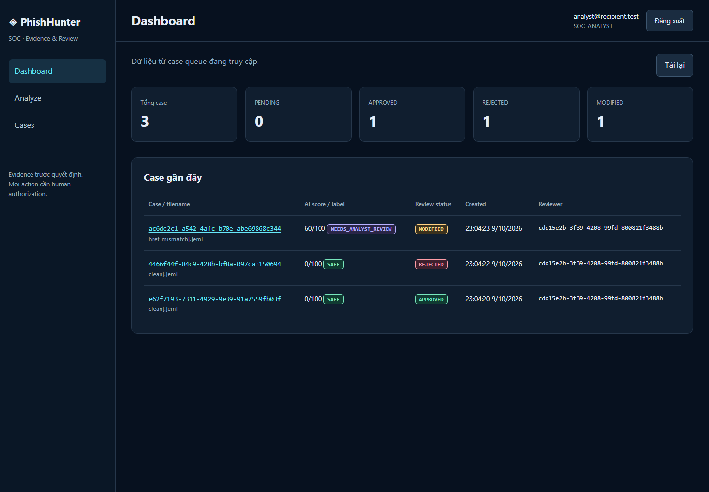
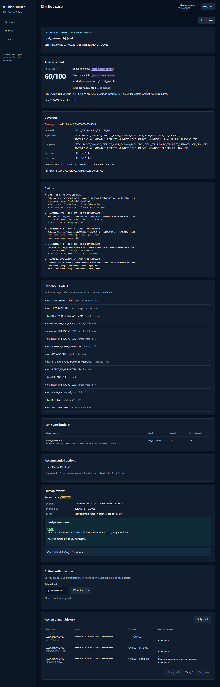

# GROUP 6 — Frontend MVP

Hoàn thành frontend Next.js App Router + TypeScript trên source hiện có. Đã đọc
schema/router backend GROUP 1–5 và tích hợp theo contract thực tế. Không sửa
backend source, migration, Risk Engine hay analyzer; không bắt đầu GROUP 7.

## Chức năng và API

| Route | Chức năng | API GROUP 5 |
| --- | --- | --- |
| `/` | Chuyển tới dashboard | Không thêm API |
| `/login` | Login, lấy user/role | `POST /auth/login`, `GET /auth/me` |
| `/dashboard` | Counts thực và 5 case gần đây | `GET /cases` phân trang |
| `/analyze` | Upload `.eml`, xem kết quả, mở case | `POST /analysis` multipart `file` |
| `/cases` | Danh sách phân trang, loading/error/empty | `GET /cases` |
| `/cases/[caseId]` | AI assessment, human review, audit, actions | `GET /cases/{id}`, `POST /cases/{id}/review`, `GET /cases/{id}/audit`, `POST /cases/{id}/actions`, `POST /cases/{id}/actions/{action_id}/authorize` |
| `/admin` | System audit | `GET /admin/audit` |
| `/admin/users` | List/create/update role và trạng thái user | `GET /admin/users`, `POST /admin/users`, `PATCH /admin/users/{id}` |

Các endpoint trên đều có prefix `/api/v1`. Không có mock response trong production
path. API client tự gắn Bearer token, phân biệt 401/403/404/409/413/415/422/500 và
network error. Login sai trả 401; request authenticated trả 401 sẽ xóa session.
Lỗi hiển thị thông điệp có kiểm soát, không dump response chứa dữ liệu nhạy cảm.

Dashboard lấy từng trang 100 case, loại trùng theo ID, dừng tối đa 5.000 case và
ghi rõ counts chưa đầy đủ nếu chạm giới hạn. Đây là counts từ danh sách đọc được,
không phải snapshot transaction: thay đổi đồng thời có thể ảnh hưởng kết quả.

## Auth, analyze và HITL

- Token + thời điểm hết hạn được lưu trong `sessionStorage` theo tab, có fallback
  memory nếu storage không khả dụng. Không dùng localStorage; không log/render
  token. Đây vẫn là bearer token JavaScript có thể đọc, theo kiến trúc GROUP 5;
  không thêm BFF hay đổi sang cookie HttpOnly trong GROUP 6.
- Khi khôi phục session hoặc login, gọi `/auth/me`. Logout/hết hạn xóa token.
  Route yêu cầu auth chờ xác minh trước khi hiển thị. Navigation và admin guard
  theo role chỉ phục vụ UX; backend tiếp tục quyết định authorization.
- Upload kiểm tra extension `.eml`, file rỗng và giới hạn 5 MiB trước request;
  có tên file, loading, success/error, kết quả và link case. Backend tiếp tục
  kiểm tra 413/415/422. Không đoán MIME từ tên file để thay backend validation.
- Analysis hiển thị nguyên score, label_candidate, assessment_label,
  analysis_scope, requires_review, coverage, claims + evidence_ids, evidence,
  contributions, recommended_actions, trust warnings và analyst_summary.
  Không tính lại risk hoặc suy diễn verdict.
- AI assessment là phần chỉ đọc riêng. Human review có status, reviewer,
  timestamps, reason, analyst label/summary và allowed_actions riêng.
  APPROVE/REJECT/MODIFY gửi đúng schema; MODIFY bắt buộc reason + label + summary.
  Không có trường chỉnh AI score/evidence/result. Sau mutation đọc lại case và
  audit thật. Conflict 409 hiển thị nút tải lại case.
- Action proposal/authorization dùng state model backend. Không thực thi
  quarantine/block/delete. Pending/rejected và action ngoài allowlist MODIFY
  không được authorize từ UI; backend tiếp tục enforce.
- Admin chỉ quản lý users và system audit có API thật. UI không cho tự
  demote/disable admin đang đăng nhập, khớp quy tắc backend.

## Security UI

Toàn bộ nội dung email/evidence/claim/reason/summary/metadata là React text hoặc
escaped code block. Không `dangerouslySetInnerHTML`, không render raw email HTML
hoặc attachment, không mở URL hay tạo external IOC link. Indicator được defang
khi trình bày: `https://evil.com/login` thành `hxxps://evil[.]com/login`;
domain và IP thay dấu chấm bằng `[.]`. Dữ liệu gửi tới analyzer không bị thay đổi.
Chỉ các link điều hướng nội bộ tới case/navigation được tạo.

Browser smoke dùng analyst summary chứa `` và URL; xác nhận
chỉ xuất hiện text đã escape/defang, không có ảnh được render, không chạy payload
và không có anchor HTTP/HTTPS tới IOC trong case. Response headers có nosniff,
no-referrer và X-Frame-Options DENY. Không tuyên bố đây là kiểm thử bảo mật đầy đủ.

## Dependencies và chạy local

Runtime: `next@16.4.0`, `react@19.3.0`, `react-dom@19.3.0`.
Dev: `typescript@~5.9.3`, `eslint@9.39.5`, `eslint-config-next@16.4.0`,
`@types/node@^22`, `@types/react@^19`, `@types/react-dom@^19`,
`@playwright/test@1.64.0`. Có lockfile. Không thêm UI framework/HTTP client nặng.
Node yêu cầu >=20.9; đã chạy Node 22.19.0, npm 10.9.3.

```powershell
cd frontend
Copy-Item .env.example .env.local
npm install
npm run lint
npm run build
npm run dev
```

Backend phải chạy với PostgreSQL đã migrate và user thật, như README/GROUP 5.
Origin frontend cần nằm trong backend CORS. `NEXT_PUBLIC_API_URL` là public,
build-time; cần build lại khi đổi API URL. Không đưa secret vào biến này.
Production local dùng `npm start` sau build.

Tài liệu chính thức đã đối chiếu:
[Next.js installation](https://nextjs.org/docs/app/getting-started/installation),
[ESLint](https://nextjs.org/docs/app/api-reference/config/eslint),
[environment variables](https://nextjs.org/docs/app/guides/environment-variables).

## Kiểm chứng

| Lệnh / kiểm tra | Kết quả |
| --- | --- |
| `python -m compileall src` | PASS |
| `pytest -q` | PASS — 103 tests |
| `ruff check src tests` (đã kiểm tra thêm `scripts/smoke_group6.py`) | PASS |
| `npm install` | PASS |
| `npm run lint` | PASS — ESLint, 0 warnings |
| `npm run build` | PASS — production build + TypeScript, các route trên được build |
| Chromium workflow với frontend production + FastAPI thật | PASS — 5 tests, 12 giây |
| `npm audit --omit=dev` | 0 vulnerabilities |

Smoke qua trình duyệt thật được tự động hóa bằng Playwright, không phải click tay.
Không mock API hoặc override current-user/auth. Dùng test adapter SQLite cô lập
của GROUP 5 để chạy migrations, auth thật, persistence/audit và toàn pipeline.
**PostgreSQL runtime / browser workflow trên PostgreSQL: NOT VERIFIED** do môi
trường chưa có Docker daemon/PostgreSQL khả dụng. Không có SQLite fallback ở
production; không coi SQLite smoke là xác minh PostgreSQL.

Năm workflow đã PASS:

1. Analyst login → clean upload → AI 0/SAFE → APPROVE → refresh vẫn APPROVED →
   authorize QUARANTINE → audit có REVIEW_APPROVED/ACTION_AUTHORIZED → logout.
2. Case khác REJECT → refresh vẫn REJECTED; tab cũ review nhận HTTP 409, tải lại
   trạng thái thật; action bị khóa authorization.
3. Href mismatch upload → AI 60/NEEDS_ANALYST_REVIEW → MODIFY với reason,
   analyst SAFE → refresh AI vẫn 60/NEEDS_ANALYST_REVIEW, human SAFE riêng;
   HTML payload không thực thi, URL đã defang.
4. Unauthenticated redirect, login sai HTTP 401, analyst bị chặn admin UX 403,
   wrong extension/oversize chặn trước upload, malformed thật HTTP 422,
   case UUID không tồn tại HTTP 404.
5. Admin login → đọc system audit → tạo user → đổi role qua API thật.

Để chạy lại trên isolated test DB, sau `npm install` và build (API URL mặc định
localhost:8000), từ root repository:

```powershell
cd frontend
npx playwright install chromium
cd ..
& .venv\Scripts\python.exe -m scripts.smoke_group6 --test-db
```

Script tạo password/JWT secret ngẫu nhiên, migrate DB tạm, bật hai server,
chạy browser, dừng server và xóa DB tạm khi kết thúc. Không có user/password mặc
định trong production. Port 8000 phải trống; script không tái sử dụng hoặc tắt
server đang chạy. Nếu đổi port, `SMOKE_API_PORT` phải khớp URL đã build. Trace/video
và screenshot tự động khi lỗi bị tắt để tránh ghi login credentials/token.

Ảnh từ lần chạy PASS (dữ liệu synthetic test):





## Files created — 21

```text
frontend/package.json
frontend/package-lock.json
frontend/tsconfig.json
frontend/next-env.d.ts
frontend/next.config.ts
frontend/eslint.config.mjs
frontend/.env.example
frontend/.gitignore
frontend/src/components/auth/AuthProvider.tsx
frontend/src/hooks/useResource.ts
frontend/src/components/ui/Feedback.tsx
frontend/src/utils/defang.ts
frontend/src/components/cases/CaseTable.tsx
frontend/src/components/cases/CaseWorkspace.tsx
frontend/src/components/hitl/ActionAuthorization.tsx
frontend/playwright.config.ts
frontend/tests/workflow.spec.ts
scripts/smoke_group6.py
docs/group6-frontend-mvp.md
docs/examples/group6-dashboard.png
docs/examples/group6-case-review.png
```

## Files modified — 26

```text
README.md
frontend/src/lib/api.ts
frontend/src/lib/auth.ts
frontend/src/lib/types.ts
frontend/src/hooks/useAuth.ts
frontend/src/hooks/useAnalysis.ts
frontend/src/utils/format.ts
frontend/src/components/layout/AppShell.tsx
frontend/src/components/layout/Header.tsx
frontend/src/components/layout/Sidebar.tsx
frontend/src/components/analysis/AnalysisSummary.tsx
frontend/src/components/analysis/EmailUpload.tsx
frontend/src/components/analysis/EvidenceList.tsx
frontend/src/components/analysis/RiskScore.tsx
frontend/src/components/analysis/VerdictBadge.tsx
frontend/src/components/hitl/ReviewActions.tsx
frontend/src/components/hitl/ReviewHistory.tsx
frontend/src/app/globals.css
frontend/src/app/layout.tsx
frontend/src/app/page.tsx
frontend/src/app/login/page.tsx
frontend/src/app/dashboard/page.tsx
frontend/src/app/cases/page.tsx
frontend/src/app/cases/[caseId]/page.tsx
frontend/src/app/admin/page.tsx
frontend/src/app/admin/users/page.tsx
```

Files deleted: **0**. Không tính generated artifacts `.next/`, `node_modules/`,
test-results hoặc bytecode vào danh sách source. Không thay source
`frontend/src/app/analyze/page.tsx` vì page hiện có đã compose đúng components.

## Giới hạn / blocked

- PostgreSQL runtime chưa xác minh như mô tả trên. Cần môi trường PostgreSQL để
  xác minh browser workflow với DB production.
- `npm audit` đầy đủ còn **5 high advisories trong dev tooling** qua chuỗi
  `braces → micromatch → fast-glob → @next/eslint-plugin-next/eslint-config-next`.
  Registry hiện chỉ cung cấp braces 3.0.3, chưa có bản vá tương ứng; không dùng
  `audit fix --force` để hạ Next sang major cũ. Runtime-only audit là 0.
  ESLint 9 được pin vì peer dependency của bộ Next plugins; registry đánh dấu
  nhánh này deprecated. Đây là giới hạn tooling còn lại, không báo audit sạch.
- Không gọi LLM, VirusTotal, urlscan, IOC feed hoặc Qdrant/RAG thật; giữ nguyên
  giới hạn static_local/static_local_partial và coverage backend trả về.
- Không làm action execution, đổi auth design, backend tuning hay GROUP 7.

Dừng sau GROUP 6.
