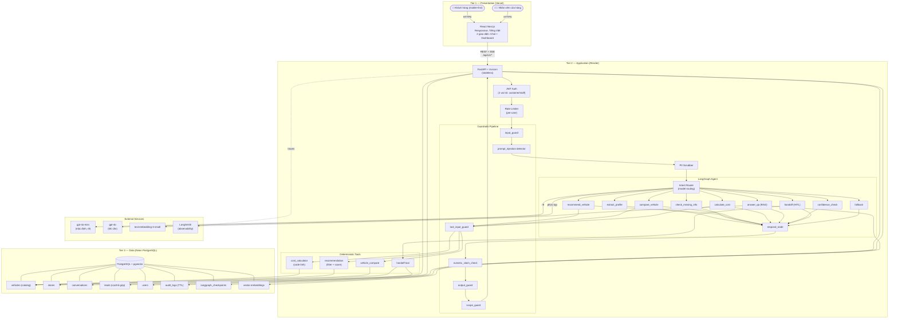
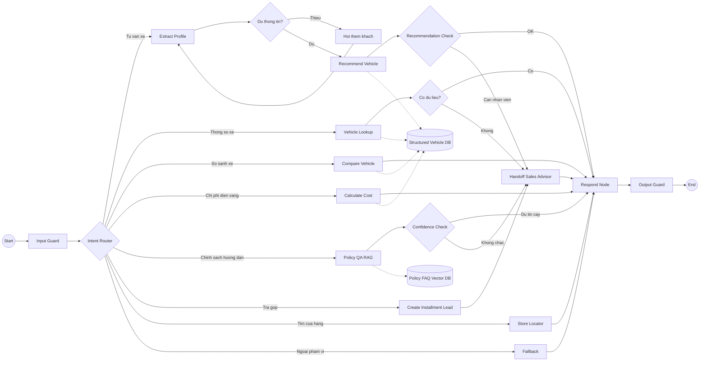

# Kiến trúc hệ thống — Xe X AI Agent

> Tài liệu này mô tả kiến trúc mục tiêu của hệ thống "Xe X AI Agent tư vấn xe máy điện",
> theo ràng buộc PRD (docs/prd.md) mục 6.2.3. Được tạo trong task T-002.
> Thiết kế cho 100 người dùng đồng thời (CCU) — mức mục tiêu demo.

## 1. Tổng quan hệ thống

Hệ thống 3 lớp (3-tier): Web (Next.js/React) → FastAPI → LangGraph Agent → Postgres + pgvector → LLM.

- **Tier 1 — Presentation:** React (Next.js) responsive, mobile-first, tiếng Việt. Deploy trên Vercel. 2 giao diện: chat khách hàng + dashboard nhân viên.
- **Tier 2 — Application:** FastAPI stateless trên Render. LangGraph agent orchestration. Guardrails pipeline. Deterministic tools (code tính chi phí, trả góp — LLM KHÔNG tính).
- **Tier 3 — Data:** Neon PostgreSQL (free tier) + pgvector extension. LangGraph checkpoints, catalog xe, đơn hàng, audit log.

### Sơ đồ tổng quan

### Sơ đồ luồng Agent (LangGraph)

## 2. API Contract

### 2.1. Tổng quan Endpoint

Prefix: `/api/v1`

#### Auth (PRD §5.3)

| Method | Endpoint | Mô tả | Auth |
|--------|----------|-------|------|
| POST | `/auth/register` | Đăng ký (demo) | Public |
| POST | `/auth/login` | Đăng nhập → JWT | Public |

#### Chat — Tư vấn + Q&A (PRD §3.1)

| Method | Endpoint | Mô tả | Auth |
|--------|----------|-------|------|
| POST | `/chat` | Gửi tin nhắn → agent trả lời (SSE streaming) | Customer/Staff |
| GET | `/chat/conversations` | Danh sách hội thoại của user | Customer/Staff |
| GET | `/chat/conversations/{id}` | Chi tiết 1 hội thoại | Owner only |

#### Vehicles — Catalog + So sánh (PRD §3.1, §3.2, §3.6)

| Method | Endpoint | Mô tả | Auth |
|--------|----------|-------|------|
| GET | `/vehicles` | Danh sách xe (filter) | Public |
| GET | `/vehicles/{id}` | Chi tiết xe + nguồn + ngày cập nhật | Public |
| POST | `/vehicles/compare` | So sánh 2+ xe | Customer/Staff |
| POST | `/vehicles/cost-compare` | So sánh chi phí điện vs xăng (code tính) | Customer/Staff |

#### Leads — Trả góp + Cọc + HITL (PRD §3.3, §3.4)

| Method | Endpoint | Mô tả | Auth |
|--------|----------|-------|------|
| POST | `/leads/installment` | Tạo đơn trả góp (status=pending_review) | Customer |
| POST | `/leads/deposit` | Tạo đơn cọc mô phỏng | Customer |
| GET | `/leads` | Danh sách đơn (phân quyền) | Customer/Staff |
| GET | `/leads/{id}` | Chi tiết đơn | Owner/Staff cùng cửa hàng |
| PATCH | `/leads/{id}/review` | **NV duyệt/từ chối trả góp (HITL)** | **Staff only** |

#### Stores — Cửa hàng (PRD §3.5)

| Method | Endpoint | Mô tả | Auth |
|--------|----------|-------|------|
| GET | `/stores` | Tìm cửa hàng (lat, lng, radius) | Public |

#### Health

| Method | Endpoint | Mô tả | Auth |
|--------|----------|-------|------|
| GET | `/health` | Health check | Public |
| GET | `/api/v1/status` | Agent status | Public |

### 2.2. Schema chính (Pydantic)

**Đã có trong `src/models/schemas.py`:**

- `ChatRequest(message: str)` — cần mở rộng thêm `conversation_id`
- `ChatResponse(response: str, analysis: str)` — cần mở rộng thêm `conversation_id, sources, warnings`

**Cần tạo mới** (trong `src/schemas/`):

| File | Schema | Fields chính |
|------|--------|-------------|
| `src/schemas/auth.py` | `RegisterRequest` | name, phone, password, role, store_id? |
| | `LoginRequest` | phone, password |
| | `TokenResponse` | access_token, token_type, role |
| `src/schemas/chat.py` | `ChatRequest` (mở rộng) | message, conversation_id? |
| | `ChatResponse` (mở rộng) | response, conversation_id, sources: list[Source], warnings: list[str], metadata |
| | `Source` | field_name, value, catalog_source, updated_at |
| | `ConversationSummary` | id, created_at, last_message_preview, status |
| `src/schemas/vehicle.py` | `VehicleSummary` | id, name, variant, price, range_km, image_url |
| | `VehicleDetail` | ...specs, source, updated_at |
| | `CompareRequest` | vehicle_ids: list[str] |
| | `CostCompareRequest` | vehicle_id, km_per_day, charging_location, gas_price?, electric_price? |
| | `CostCompareResponse` | electric_monthly, gas_monthly, savings, assumptions, warnings |
| `src/schemas/lead.py` | `InstallmentRequest` | vehicle_id, down_payment, months, customer_name, phone |
| | `DepositRequest` | vehicle_id, amount, customer_name, phone |
| | `LeadResponse` | lead_id, status, monthly_payment?, total_cost?, created_at |
| | `ReviewRequest` | decision: Literal["approved", "rejected"], note? |
| `src/schemas/store.py` (**mới**) | `StoreInfo` | id, name, address, lat, lng, phone, distance_km? |

## 3. Lựa chọn công nghệ

| Thành phần | Công nghệ | Gói/Tier | Chi phí | Giới hạn | Nguồn PRD |
|------------|-----------|----------|---------|----------|-----------|
| Frontend | Next.js (React) | Vercel Hobby | $0 | 100GB bandwidth, 1M func invocations, non-commercial only | §5.5, §6.2.3 |
| Backend | FastAPI + Uvicorn | Render Free / Starter | $0 (dev) / $7 (Demo Day) | 512MB RAM, 0.1 CPU | §5.5, §6.2.3 |
| Database | PostgreSQL | Neon Free | $0 | 0.5GB storage, 100 CU-hours, built-in PgBouncer | §6.2.3 |
| Vector DB | pgvector | Neon (chung) | $0 | Chung 0.5GB | §6.2.3 |
| LLM mặc định | gpt-4o-mini | OpenAI API | ~$0.79/ngày thường | $0.15/1M input, $0.60/1M output | §3.6, §5.4 |
| LLM mạnh | gpt-4o | OpenAI API | Chỉ dùng khi cần | ~$2.50/1M input, $10/1M output | §3.6 |
| Embeddings | text-embedding-3-small | OpenAI API | <$0.01/ngày | $0.02/1M token | §6.2.3 |
| Auth | JWT (python-jose) | Open-source | $0 | — | §5.3 |
| Rate Limit | slowapi | Open-source | $0 | — | §5.3 |
| Checkpointer | langgraph-checkpoint-postgres | Open-source | $0 | — | §5.4 |
| Observability | LangSmith | Free tier | $0 | 5K traces/tháng | §5.5 |

**Tổng chi phí vận hành ước tính: ~$43–50/tháng** (chủ yếu LLM API). Infra miễn phí.

### Hai chế độ vận hành Render

| | Dev/Test (bình thường) | Demo Day |
|---|---|---|
| Plan | Render Free ($0) | Render Starter ($7/tháng) |
| Spin-down | Sau 15 phút idle → cold start 30-60s | Không spin-down |
| KPI "chữ đầu tiên < 2s" (PRD §5.1) | ❌ Không đạt nếu cold start | ✅ Đạt |
| Chi phí | $0 | ~$0.50–1.00 cho 2–3 ngày Starter |

Chuyển đổi: Render Dashboard → service → Settings → Instance Type → đổi Free ↔ Starter. Downtime ~30s.

### Khả năng chịu tải (100 CCU)

| Thành phần | Đánh giá |
|------------|----------|
| Vercel Free | ✅ Đủ — 100GB bandwidth cho demo |
| Render Starter | ✅ Đủ — 512MB RAM cho FastAPI stateless, không spin-down |
| Neon Free | ✅ Đủ — PgBouncer chấp nhận 10K connections, 0.5GB đủ cho demo data; cold start ~1-2s sau idle |
| gpt-4o-mini | ✅ Đủ — OpenAI rate limit mặc định đủ cho 100 CCU |
| Điểm nghẽn tiềm ẩn | Neon scale-to-zero (giảm thiểu: keep-alive ping); Render cold start (giảm thiểu: dùng Starter khi demo); LLM cost spike khi traffic cao (giảm thiểu: token budget + semantic cache) |

### Ước tính chi phí LLM

**Quy đổi 100 CCU → số hội thoại/ngày [GIẢ ĐỊNH — cần xác nhận với dữ liệu demo thực tế]:**

| Thông số | Giả định | Cơ sở |
|----------|----------|-------|
| CCU cao điểm | 100 người chat cùng lúc | Yêu cầu thiết kế |
| Thời lượng phiên trung bình | ~10 phút (5 lượt trao đổi) | Tư vấn xe: hỏi nhu cầu → gợi ý → so sánh → hỏi thêm → chốt |
| Vòng quay mỗi slot | ~6 phiên/giờ (60 ÷ 10) | Tính từ thời lượng phiên |
| Giờ cao điểm | ~2 giờ/ngày (Demo Day) | Thời gian sự kiện demo |
| Giờ bình thường | ~6 giờ/ngày, CCU trung bình ~15 | Ngoài cao điểm |
| Tổng/ngày (Demo Day) | ~1.740 phiên | 100×6×2 + 15×6×6 |
| Tổng/ngày (ngày thường) | ~300 phiên | Dev/test, traffic thấp |

**Chi phí (gpt-4o-mini, ~10.000 token/phiên):**

| Chỉ số | Ngày thường (~300 phiên) | Demo Day (~1.740 phiên) |
|--------|--------------------------|-------------------------|
| Chi phí LLM/ngày | ~$0.79 | ~$4.57 |
| Chi phí LLM/tháng (25 ngày thường + 5 Demo Day) | **~$42.60** | |

Cơ chế giảm chi phí: model routing (PRD §3.6), semantic cache, token budget per conversation + per day (PRD §5.4), cached input prefix.

## 4. Bảo mật hệ thống và An toàn AI

### 4.1. Bảo mật hạ tầng/API

| Biện pháp | Nguồn PRD | Vị trí implement |
|-----------|-----------|-------------------|
| JWT Auth (2 vai trò: customer/staff) | §5.3 | `src/api/deps.py`, `src/services/auth_service.py`, `src/api/endpoints/auth.py` — **cần bổ sung** |
| Rate limiting per-user | §5.3 | `src/main.py` middleware (`slowapi`) — **cần bổ sung** |
| HTTPS/TLS | §5.3 | Vercel + Render tự cấp — ✅ đã có |
| Secret management | §5.3 | `.env` + `.gitignore` — ✅ đã có |
| Mã hóa dữ liệu nhạy cảm khi lưu | §5.3 | `src/models/` — **cần bổ sung** |
| Input validation (Pydantic) | §5.3 | `src/models/schemas.py` — ⚠️ có cơ bản, **cần mở rộng** |
| CORS | — | `src/main.py` L26-32 — ✅ đã có |
| Audit log + TTL | §5.3 | `src/observability/logger.py` + Postgres — **cần bổ sung** |
| Non-root Docker | — | `Dockerfile` L19,27 — ✅ đã có |

### 4.2. An toàn mô hình AI

| Biện pháp | Nguồn PRD | Vị trí implement |
|-----------|-----------|-------------------|
| Chống prompt injection | §5.3, §7.2 | `src/guardrails/prompt_injection.py` — **cần bổ sung logic** |
| PII scrubber (che PII trước LLM) | §5.6, §7.3 | `src/guardrails/input_guard.py` hoặc tạo mới `pii_scrubber.py` — **cần bổ sung** |
| Không lưu CCCD trong chat | §7.3, §8.2 | `src/guardrails/input_guard.py` — **cần bổ sung** |
| Giới hạn phạm vi tool | §7.2 | `src/guardrails/tool_input_guard.py` — **cần bổ sung logic** |
| Scope guard (từ chối ngoài phạm vi) | §6.2.2, §8.1 | `src/guardrails/scope_guard.py` + `fallback.py` — **cần bổ sung** |
| Numeric claim check | §5.2, §8.1 | `src/guardrails/numeric_claim_check.py` — **cần bổ sung logic** |
| Output guard (không lộ system prompt) | §5.6 | `src/guardrails/output_guard.py` — **cần bổ sung logic** |
| Token budget (per conversation + per day) | §5.4 | `src/services/llm.py` — **cần tạo mới** |
| Model routing | §3.6, §5.4 | `src/agents/router.py` + `src/services/llm.py` — **cần bổ sung logic** |
| Timeout + fallback | §5.1, §7.2 | `src/agents/nodes/fallback.py` + `src/services/llm.py` — **cần bổ sung** |
| Cảnh báo khách chưa đủ tuổi | §5.6 | `src/guardrails/input_guard.py` — **cần bổ sung** |
| Cảnh báo ước tính | §5.2, §6.2.2 | `src/guardrails/output_guard.py` — **cần bổ sung** |
| HITL enforcement | §5.3, §6.2.2, §8.1 | `PATCH /leads/{id}/review` staff-only — **cần bổ sung** |
| Tuân thủ Luật 91/2025/QH15 và NĐ 356/2025/NĐ-CP | §5.6 | Data minimization, PII scrubbing, data mapping — **cần implement** |

### 4.3. Data mapping (PRD §5.6)

| Dữ liệu | Lưu ở đâu | Gửi tới đâu | Xử lý PII |
|----------|-----------|-------------|-----------|
| Tin nhắn hội thoại | Neon Postgres | OpenAI API (Mỹ) — sau PII scrubbing | SĐT, tên, CCCD → placeholder |
| Profile khách | Neon Postgres | KHÔNG gửi LLM | Encrypt phone khi lưu |
| Catalog xe | Neon Postgres | Không gửi bên ngoài | Dữ liệu công khai |
| Vector embeddings | Neon (pgvector) | OpenAI Embeddings (1 lần khi seed) | Chỉ embed catalog (public) |
| Audit log | Neon Postgres | Không gửi bên ngoài | TTL 30 ngày |
| LLM traces | LangSmith (Mỹ) | LangSmith servers | Sau PII scrubbing |

## 5. ADR — Tổng hợp quyết định kiến trúc

### ADR-T002: Kiến trúc hệ thống Xe X AI Agent

**Status:** Proposed | **Date:** 2026-09-22

| # | Quyết định | Lý do | Ràng buộc PRD | Trade-off | Trạng thái implement (audit 2026-09-24) |
|---|-----------|-------|---------------|-----------|---------------------------------------|
| D1 | Neon Postgres (free) + pgvector | Free vĩnh viễn, built-in PgBouncer, hỗ trợ pgvector | §6.2.3 | Cold start sau idle; 0.5GB storage | — |
| D2 | pgvector thay ChromaDB | Tiết kiệm 1 dịch vụ; catalog nhỏ đủ dùng | §6.2.3 | Kém hơn Pinecone ở quy mô lớn | — |
| D3 | gpt-4o-mini mặc định + gpt-4o fallback | Chi phí thấp; routing theo PRD | §3.6, §5.4 | Chất lượng kém hơn cho câu khó | — |
| D4 | JWT stateless (2 vai trò) | Đơn giản, phù hợp backend stateless | §5.3 | Không có OAuth2 phức tạp | — |
| D5 | Deterministic tools cho tài chính | PRD bắt buộc: code tính, LLM không tính | §5.2, §6.2.3 | Cần maintain code riêng | — |
| D6 | PostgresSaver cho checkpoints | Stateless backend, scale ngang | §5.4 | Ước tính ~5-10ms/step (chưa benchmark thật) | — |
| D7 | PII scrubber trước mọi LLM call | Luật 91/2025 + PRD §7.3 | §5.6, §7.3 | Có thể false positive | — |
| D8 | SSE streaming cho chat | Đạt "chữ đầu tiên < 2s" | §5.1 | Frontend cần EventSource | — |
| D9 | Audit log TTL 30 ngày | Tuân thủ PRD + quản lý storage | §5.3 | Xóa log sau 30 ngày; trường hợp cần giữ để điều tra phải theo quy trình lưu giữ riêng | — |
| D10 | 2 chế độ Render: Free / Starter | Tiết kiệm + đảm bảo KPI demo | §5.1, §5.5 | Cần nhớ upgrade | — |
| D11 | Bộ eval ≥ 50 câu | Đo KPI tự động theo PRD | §5.2, §8.1 | Cần xây fixture | — |
| D12 | Token/cost budget theo hội thoại và theo ngày: giới hạn token mỗi hội thoại, giới hạn tổng chi phí mỗi ngày; cảnh báo gần ngưỡng và chặn hoặc hạ mức phục vụ khi vượt ngưỡng | Kiểm soát chi phí LLM theo PRD; ngưỡng cụ thể cấu hình trước vận hành dựa trên giá và traffic đo được | §5.4 | Cần theo dõi usage/cost và chọn ngưỡng; chặn yêu cầu có thể làm gián đoạn hội thoại | Thiết kế xong, CHƯA implement |
| D13 | HITL bắt buộc cho trả góp: agent chỉ tạo lead với `status=pending_review`; chỉ `PATCH /leads/{id}/review` với `role=staff` mới được đổi trạng thái | Bảo đảm nhân viên duyệt trước khi xác nhận trả góp | §5.3, §6.2.2, §8.1 | Tạo độ trễ và phụ thuộc nhân viên xử lý review | ❌ Chưa implement (theo audit code hiện tại) |

`—` nghĩa là trạng thái implement của D1-D11 không được cập nhật trong lần chỉnh sửa ADR này.

**Hướng mở rộng tương lai:** Nếu cần scale vượt 100 CCU sau giai đoạn demo — nâng Render lên Standard ($25/tháng), Neon Launch dùng pay-as-you-go (compute $0.106/CU-hour, storage $0.35/GB-tháng; [trang giá Neon](https://neon.com/pricing)), xem xét vector DB chuyên biệt. Chi phí thực tế phụ thuộc mức sử dụng, cần đo lại khi có traffic thật. Chưa cần thiết kế chi tiết ở giai đoạn demo 6 tuần này.

## 6. Hỗ trợ bộ eval tự động

Theo PRD §5.2, §5.6, §8.1, kiến trúc hỗ trợ:

- Thư mục `eval/` (đã có trong scaffold) chứa bộ eval ≥ 50 câu.
- Chạy được qua CLI: `pytest eval/` hoặc script riêng.
- Đo: độ chính xác 100% vs catalog, tỷ lệ bịa = 0%, từ chối ngoài phạm vi ≥ 90%.
- Fixture dùng cùng DB seed data trong `src/db/seed.py`.
- Chạy mỗi khi đổi prompt (CI/CD hook hoặc manual).

## 7. Danh sách file tham chiếu

| File | Vai trò | Dòng quan trọng |
|------|---------|----------------|
| `src/agents/graph.py` | Graph hiện tại (2 node scaffold) | L14-26 |
| `src/agents/state.py` | AgentState TypedDict | L6-18 |
| `src/agents/nodes/example_node.py` | Node scaffold mẫu | L4-26 |
| `src/agents/tools/example_tool.py` | Tool scaffold (calculator + search stub) | L20-71 |
| `src/api/routes.py` | 2 endpoint hiện có | L9-25 |
| `src/models/schemas.py` | ChatRequest + ChatResponse | L1-11 |
| `src/services/llm.py` | get_llm() → ChatOpenAI | L6-12 |
| `src/config.py` | Settings: model_name, database_url | L8-37 |
| `src/main.py` | FastAPI app, CORS, router mount | L1-39 |
| `Dockerfile` | Multi-stage build, non-root | L1-35 |
| `docker-compose.yml` | Backend only | L1-20 |
| `requirements.txt` | Dependencies (DB commented out) | L13-19 |
| `.env.example` | Env vars template | L1-45 |
| `docs/prd.md` | PRD đầy đủ | L1-338 |

## 8. Thuật ngữ

| Thuật ngữ | Ý nghĩa |
|---|---|
| **Scaffold** | Trong phát triển phần mềm, là bộ khung/mã nền tảng ban đầu được dựng sẵn để phát triển tiếp (ví dụ: node scaffold là node mẫu có cấu trúc cơ bản). Có thể dịch là **khung sườn** hoặc **bộ khung khởi tạo**; không có nghĩa là sơ đồ. |
